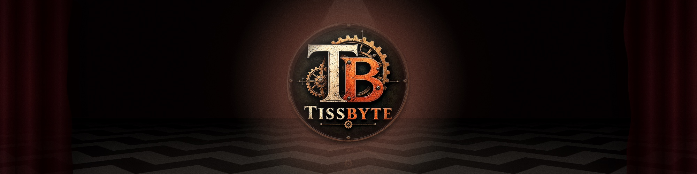

  

<h3 align="center">Hand-sewn software. Built for fun.</h3>

  
  

# ⚙️ Who we are

**TissByte** is a small French 🇫🇷 software factory. We are here to have fun, to improve our lives as human beings, and to offer the result to others.

## ✒️ The story

It always starts the same way: something annoys us.

A tedious task. A broken routine. A tool that almost works.

So we ask a machine. It answers, imperfectly. We ask again. Somewhere between the first prompt and the last commit, something exists that didn't before.

And our day gets a little lighter.

We figured we couldn't be the only ones. So what we build for ourselves, we offer to others.

We don't claim to be state of the art. We just like building things that help.

Yours could be next.

## 🧵 Why TissByte?

Because software should be hand-sewn, and fun to make.

There is always something that bothers us, and we can solve it. What you find here are things we wanted. They exist now.

Your dream isn't someone else's. So nobody thinks for you here.

## 🗝️ What we propose

- **Made to measure.** Tell us what bothers you, or what you dream of. We build it exactly as you picture it.
- **Agile.** A direct line, no committee. You talk to the people who build it.
- **Free.** Between requests, our members build tools that make their own lives easier, and publish them for free.
